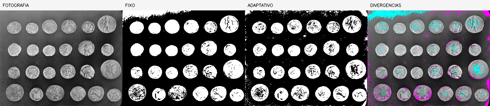
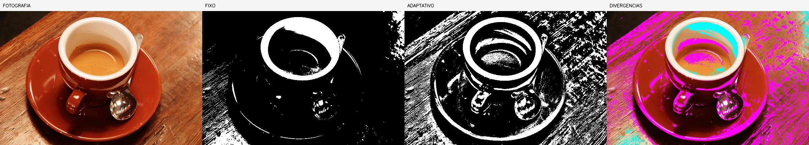
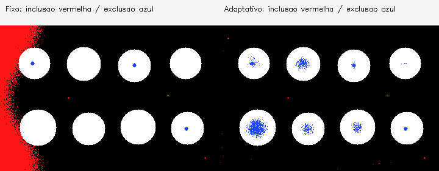
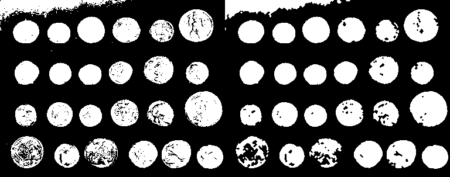
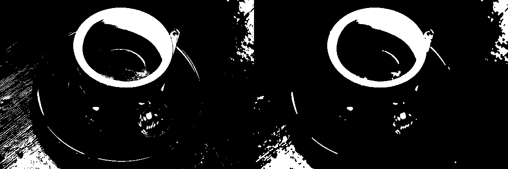
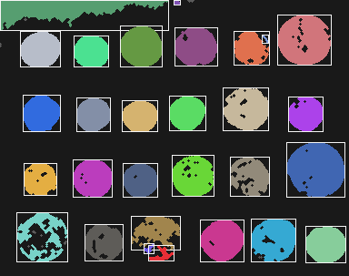

# Relatório técnico — Laboratórios M2.1 e M2.2

**Estudante:** Victor Hugo Chrisosthemos Teixeira  
**Disciplina:** Processamento de Imagens — 2026/02

## M2.1 — Máscara binária e segmentação

### Alvo, imagens e pré-processamento

O objetivo do programa é segmentar **regiões mais claras, aproximadamente circulares**, separando-as do fundo. Foram comparadas duas fotografias reais obtidas de uma biblioteca pública de imagens: uma com **24 moedas** visíveis sobre um fundo de cinza variável (`foto_moedas.png`) e outra com **uma xícara e um pires** sobre uma mesa com muita textura (`foto_xicara.png`). São categorias diferentes de objeto, o que serve para examinar como o método responde a diferentes cenas, mas limita uma interpretação da contagem como classificação semântica. As origens e permissões estão em `FOTOS_FONTES.md`.

Também foram usadas duas imagens **sintéticas**, `scene_uniform.png` e `scene_uneven.png`, com oito discos escuros em fundo claro, e suas referências geradas automaticamente. Elas permitem testes controlados, mas não substituem as fotografias. Para segmentação, cada entrada passa apenas por conversão para tons de cinza. Não foi utilizado filtro prévio; essa decisão mantém clara a influência do método de limiarização. Para as fotografias, usamos `foreground=light`; para os discos sintéticos escuros, `foreground=dark`, ou seja, `THRESH_BINARY_INV`.

A máscara final mantém as dimensões da entrada, 1 canal e apenas 0 (fundo) e 255 (primeiro plano). O programa verifica isso automaticamente, registra a quantidade e proporção de pixels brancos, e grava uma saída PNG sem perdas.

### Métodos e parâmetros

Foram usados dois métodos nas **mesmas duas fotografias**:

- **Limiar fixo em cinza**, valores 120 nas moedas e 170 na xícara. O objeto claro deve ter intensidade maior que esse limite; esse valor muda de uma cena para outra porque o fundo e a iluminação são diferentes.
- **Limiar adaptativo gaussiano**, bloco de **75×75 pixels**, `C=-4`, objeto claro. Nesse caso cada região utiliza um limite local, mas detalhes da mesa podem ser marcados indevidamente como primeiro plano.

Não há suavização anterior. O programa também disponibiliza Otsu como método adicional, mas o experimento mínimo compara fixo e adaptativo. Nas duas cenas sintéticas usaram-se limiar fixo 120 e adaptativo gaussiano com bloco 75 e `C=8`, em ambos os casos com inversão para objetos escuros.

### Proporção de primeiro plano nas fotografias (dados medidos)

| Entrada | Método | Parâmetro específico | Pixels brancos | Proporção |
|---|---|---|---:|---:|
| Moedas (384×303) | Fixo | 120 | 38.336 | 32,95% |
| Moedas (384×303) | Adaptativo | bloco 75, C=-4 | 37.188 | 31,96% |
| Xícara (600×400) | Fixo | 170 | 29.254 | 12,19% |
| Xícara (600×400) | Adaptativo | bloco 75, C=-4 | 70.243 | 29,27% |

Esses percentuais correspondem à **área branca da máscara**, não a uma taxa de acerto. Não existe anotação de referência para as fotografias, então não são informadas precisão, revocação nem acurácia. A divergência entre os dois métodos é de **8.408 pixels** nas moedas e **55.107 pixels** na xícara, mas essa diferença também não determina qual é o melhor resultado sozinha.

### Evidências visuais e análise

**Figura 1 — Moedas, fotografia original, máscara fixa, adaptativa e regiões de divergência.** A máscara fixa contém a maior parte das moedas, mas algumas ficam com detalhes internos pretos e partes do contorno incompletas. A adaptativa também inclui partes do fundo, em especial onde a iluminação muda. Escolhi **fixo 120** para a etapa M2.2 desta fotografia pela continuidade dos contornos e pelo menor espalhamento de pixels isolados observado em parte da cena.

**Figura 2 — Xícara e pires, fotografia original, máscara fixa, adaptativa e divergências.** A máscara fixa destaca bordas claras da xícara, mas não recupera todo o objeto. A adaptativa recupera mais regiões luminosas; no entanto, ela marca muitos detalhes da textura da madeira. Nessa entrada **não há boa separação do objeto completo por simples limiarização**. Escolhi **fixo 170** para M2.2 por ter menos fundo marcado, reconhecendo que também perde parte do pires. O ponto mais sensível aqui é o valor de limiar/C diante da variação de intensidade do fundo.

Nos painéis acima, a última coluna mostra apenas **discordância dos métodos**: ciano para pontos que aparecem somente no fixo e magenta para os que aparecem apenas no adaptativo. Não é possível chamá-los com segurança de falso positivo e falso negativo sem referência anotada. Pela observação das fotografias, textura do fundo marcada indevidamente pode criar **componentes falsos**, enquanto falhas nos contornos podem **quebrar objetos em vários componentes**.

### Casos controlados com referência conhecida

| Cena artificial | Método | Pixels brancos | Proporção | Inclusões erradas | Exclusões erradas |
|---|---|---:|---:|---:|---:|
| Fundo uniforme | Fixo 120 | 18.945 | 21,93% | 20 | 87 |
| Fundo uniforme | Adaptativo 75, C=8 | 18.686 | 21,63% | 24 | 350 |
| Fundo desigual | Fixo 120 | 27.847 | 32,23% | 8.922 | 87 |
| Fundo desigual | Adaptativo 75, C=8 | 17.958 | 20,78% | 31 | 1.085 |

Nas cenas geradas, ao contrário das fotos, a referência verdadeira é conhecida. O limiar fixo foi melhor na cena uniforme, mas incluiu muitos pixels de fundo na cena de iluminação desigual. A alternativa adaptativa reduziu o excesso de fundo nesse caso, embora tenha perdido mais pixels internos dos discos. Nas imagens abaixo, **vermelho** representa fundo incluído e **azul**, pedaço de objeto perdido, calculados contra as máscaras artificiais originais.

**Figura 3 — Erros medidos da cena sintética de iluminação desigual, fixo à esquerda e adaptativo à direita.**

## M2.2 — Componentes conexos e sequência morfológica

### Procedimento

Para cada máscara selecionada em M2.1, o programa conta os componentes iniciais usando **conectividade 4** e **conectividade 8 na mesma máscara**. Fundo = rótulo 0 (não entra no CSV), e os objetos são contados como regiões de primeiro plano. A conexão 4 considera os vizinhos horizontal e vertical; a conexão 8 acrescenta diagonais. Em ambos os casos, o resumo distingue contagem bruta de contagem filtrada por área (`min-area=20`). O filtro não apaga os componentes brutos do CSV.

Depois são aplicadas duas operações nesta ordem: **abertura (open)** para reduzir pontos isolados do fundo e **fechamento (close)** para ajudar a preencher falhas pequenas nos objetos. O elemento estruturante é **elíptico 3×3**, com **uma iteração** de cada operação. As imagens de cada estágio são guardadas para comparação antes/depois. Isso é uma escolha experimental, não uma garantia de melhoria: a abertura pode retirar detalhes finos, e o fechamento pode unir regiões próximas.

### Componentes nas duas fotografias

| Máscara inicial | Conect. | Brutos antes | Retidos antes | Brutos depois | Retidos depois | Pixels brancos antes → depois |
|---|---:|---:|---:|---:|---:|---:|
| Moedas (fixo 120) | 4 | 190 | 27 | 40 | 30 | 38.336 → 38.192 |
| Moedas (fixo 120) | 8 | 87 | 27 | 38 | 29 | 38.336 → 38.192 |
| Xícara (fixo 170) | 4 | 1.489 | 46 | 78 | 32 | 29.254 → 25.681 |
| Xícara (fixo 170) | 8 | 566 | 49 | 75 | 30 | 29.254 → 25.681 |

No experimento das moedas, a contagem após o filtro fica próxima de 24, mas não coincide: mesmo o resultado de 29 componentes (conectividade 8, depois) **não significa 29 moedas**. Algumas moedas podem ficar fragmentadas e o fundo pode gerar áreas independentes. A abertura reduz muitos pequenos componentes, mas também remove pixels legítimos; o fechamento recupera apenas pequenas falhas. Na foto da xícara, a grande redução de regiões pequenas após a abertura mostra um benefício para reduzir ruído, mas **parte da borda do pires é perdida** e a contagem de componentes não corresponde à quantidade de utensílios reais.

**Figura 4 — Máscara de moedas, antes e depois da sequência de abertura e fechamento (conectividade 8).**

**Figura 5 — Máscara da xícara, antes e depois da sequência (conectividade 8).**

### Comparação em cenas controladas

| Máscara | Conect. | Brutos antes → depois | Retidos antes → depois | Área branca antes → depois |
|---|---:|---:|---:|---:|
| Discos uniformes (adaptativa) | 4 | 37 → 12 | 8 → 8 | 18.686 → 18.638 |
| Discos uniformes (adaptativa) | 8 | 25 → 12 | 8 → 8 | 18.686 → 18.638 |
| Discos iluminação desigual (adaptativa) | 4 | 100 → 12 | 8 → 8 | 17.958 → 17.728 |
| Discos iluminação desigual (adaptativa) | 8 | 49 → 12 | 8 → 8 | 17.958 → 17.728 |

Na cena de iluminação desigual, as operações alteraram **536 pixels** da máscara. Ainda há fragmentos após a morfologia, e alguns buracos maiores dentro dos discos não foram preenchidos; aumentar o kernel poderia ajudar em certos pontos, mas também pode unir discos ou destruir detalhes.

Um teste sintético separa regiões que se tocam **apenas na diagonal**: na conectividade 4, não existe ligação pelo canto; na 8, existe. A máscara de demonstração `images/input/diagonal_demo_mask.png` apresenta respectivamente **4 e 3 componentes brutos** antes do tratamento. Há também um teste automatizado com **exatamente dois pixels diagonais**, esperado 2 componentes na conectividade 4 e 1 na 8.

**Figura 6 — Visualização de rótulos na fotografia de moedas, com caixas delimitadoras.**

### Dados e limitações

Os arquivos `results/*_before_components.csv` e `*_after_components.csv` têm as colunas `label,area,x,y,width,height,cx,cy,kept`. O rótulo 0 é excluído. Para cada estágio, os JSONs registram área total em primeiro plano, quantidade de componentes brutos/filtrados, somas de áreas, parâmetros e pixels alterados. A soma das áreas dos componentes brutos corresponde à quantidade de pixels brancos em todas as execuções incluídas.

A contagem visual de objetos depende de textura, sombreamento, contato, detalhes internos e parâmetro de área mínima. A rotulação mede **regiões conectadas**, não necessariamente objetos físicos. Limitações, como fusão ou fragmentação, não são solucionadas automaticamente por morfologia simples. Watershed não foi implementado, pois é uma extensão opcional.

### Reprodução e testes

Execute `python tools/reproduce.py` para recriar imagens e tabelas com parâmetros documentados. Execute `python -m unittest discover -s tests -v` para validar limiar em casos extremos, binarização, máscaras vazias, borda, dimensões, conectividade, operações morfológicas, escrita dos CSVs, parâmetros e códigos de saída. Os testes e resultados atuais foram produzidos localmente; o registro está em `results/test_log.txt`.

## Fontes

Documentação oficial do OpenCV: [Thresholding](https://docs.opencv.org/4.x/d7/d4d/tutorial_py_thresholding.html), [Morphology](https://docs.opencv.org/4.x/d9/d61/tutorial_py_morphological_ops.html), [Connected Components](https://docs.opencv.org/4.x/d3/dc0/group__imgproc__shape.html). Fontes e licenças das fotos: [FOTOS_FONTES.md](FOTOS_FONTES.md). Outros documentos: contrato técnico, rubrica e enunciados M2.1/M2.2 da disciplina.

Uso de IA: ver [AI_USAGE.md](AI_USAGE.md).
